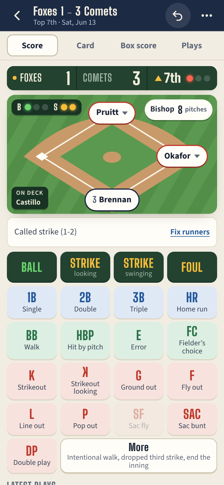
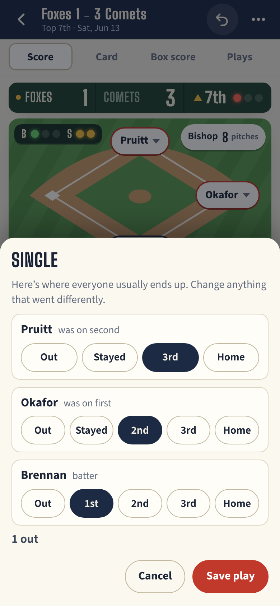
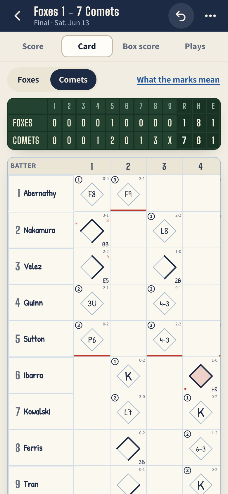
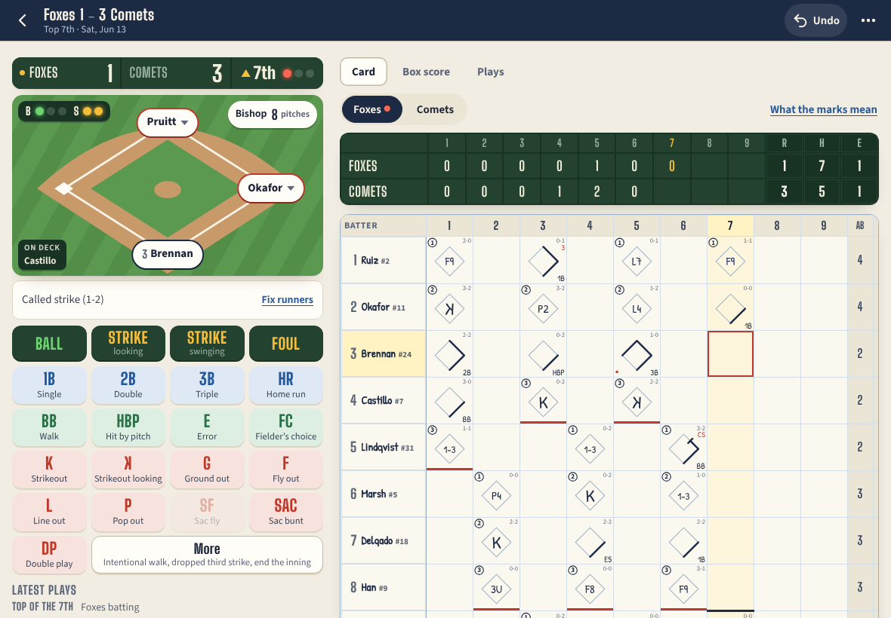

# Backwards K

**Use it: [backwards-k.junkdrawer.works](https://backwards-k.junkdrawer.works/)**

**Keep score at a baseball or softball game on your phone or tablet.** Tap what happened (Ball, Strike, Single,
Ground out 6-3) and Backwards K moves the runners, keeps the count, the outs, the score and each pitcher's pitch
count, and fills in a classic paper scorecard as you go. You don't need to know the shorthand: every play is also
written out in plain words.

<p align="center">
  
  &nbsp;
  
  &nbsp;
  
</p>

## How it works

- **Tap what happened.** Ball, Strike or Foul if you're counting pitches (four balls or three strikes finish the
  at-bat by themselves), then what the batter did: a hit, a walk, an error, a strikeout swinging or looking, a ground
  out, a fly out and the rest. Counting pitches is optional; you can tap only the results.
- **Runners move themselves.** With runners on, you see where everyone usually ends up and change whatever went
  differently. A runner marked out is out at the next base unless you say where (thrown out at the plate on a
  single), and one who got further than the play takes him did it on the play, on the throw or on an error (say whose:
  it's charged, and the run it lets in earns no RBI). Tap a runner on the field for a steal, a wild pitch, a pickoff
  or a balk; everyone who moved up on the same wild pitch or throw goes in as one play.
- **Tap the field for the fielders.** For a ground out, tap the shortstop and then the first baseman, and the card
  says 6-3. Or skip it. On a keyboard, type their numbers and press Enter.
- **Or score from a keyboard,** at a laptop or watching on TV: B ball, C called strike, S swinging strike, F foul; 1
  to 4 for a single to a home run; W walk, H hit by pitch, E error; K strikeout (Shift+K looking), G ground out, Y fly
  out, L line out, P pop out; M for More, and U or Ctrl+Z (⌘Z) to undo. G, 6, 3, Enter is a 6-3.
- **The scorecard fills itself in.** Each box has the path around the bases, the out number, the count and the RBIs,
  and a strikeout looking gets its backwards K. Tap any box to read what happened. In the play-by-play each play is
  led by its mark from the card (6-3, F8, SB, CS 2-6), so the shorthand comes with the words. A box can also be
  switched to another kind of out or another way of reaching base, and have its fielders changed; anything else is a
  job for Undo, or for Fix runners, which stays until the next batter's turn is over.
- **Undo anything.** A game is a list of what happened, so Undo takes plays back, latest first, as many as you like.
  It's at the top of the screen, and under the field beside the play it would take back, and it says which one it
  took (with Redo) when the line under the field is out of sight. Forgot a play a few back, a steal or a pitching
  change? Undo back to it and score it, and **Put back** brings back the plays Undo took, each as it was if it still
  fits: a batter's play with other runners on now asks where they went, and anything that can't have happened any
  more is left out, with a message saying which. A change made in a box has its own Undo, right after it.
- **It knows when the game is over.** Final comes when the last inning is decided, or the moment the home team goes
  ahead in it. That run is the last to count, and a hit that brings it in counts for the bases it needed, as an
  official scorer has it: with the bases loaded, a double that wins the game is a single (a home run still scores
  everyone). **Keep playing** after a Final finishes that half-inning, for a league that plays it out, and then every
  run on the play that won it counts; a game you ended early picks up where it stopped and ends the usual way.
- **Rain, lightning, a run rule, the clock.** End the game here (under More, or in the game's menu) asks why. **Stop
  for a delay** keeps the game as it was, reading "Delayed, top 5th" everywhere, lets the screen sleep, and one tap
  resumes it. **Game over: run rule** or **time limit** is a complete game, Final, with "(run rule)" or "(time
  limit)" after the score. **Called: rain or darkness** reads Called, and until the game has gone far enough to count
  (five innings, or four and a half with the home team ahead; four of six in Little League), the team in front is
  ahead, not the winner (OBR 7.01(c)).
- **League rules that run themselves.** Pick Little League (the game is over with a team 15 runs ahead after three
  innings or 10 after four, half an inning sooner for the home team: rule 4.10(e)), LL Minors (that, and five runs a
  half-inning, except in the last inning), or your league's own (Custom). A half-inning ends itself at the limit
  ("That's 5 runs: the half-inning is over.", and a run after that on the same play doesn't count, unless your league
  counts every run on it), and the game ends itself on the mercy rule, Final, with "(Final, 10-run rule, 4 innings)"
  in the score you send. The next new game starts with the same rules. Picked in Game settings partway through a
  game, they count from the last play on: rules that would change plays already scored (a half-inning that already went
  past the limit, say) aren't taken, and it says why.
- **Extra innings that start with a runner on second,** as the majors have since 2020 and many tournaments do: turn it
  on in New game (from the first extra inning) or pick the inning in Game settings. Each half-inning from then on
  starts with the batter before its leadoff man on second (OBR 7.01(b)), in a box of his own marked AR, with a line in
  the plays. He isn't a trip to the plate, and his run is unearned for the pitcher (the one who started the inning).
- **Pitch limits for youth pitchers.** With pitches counted, pick Little League's limit by league age (Regulation
  VI(c): 50 at 7-8, 75 at 9-10, 85 at 11-12, 95 at 13-16, 105 at 17-18), Pitch Smart's (the same, and 120 at 19-22),
  or a number. The pitcher's button turns amber 5 pitches before it, and red at it, with "finish this batter" (Little
  League lets the pitcher finish the batter the limit was reached on). The pitcher's sheet and the box score say the
  days of rest each pitcher needs after the game (VI(d): through 14, none after 1-20 pitches, then a day each after
  21, 36, 51 and 66; at 15 and up the steps are 31, 46, 61 and 76, and Pitch Smart's 19-22 has a fifth after 106),
  and in Little League, who threw 41 or more and can't catch that day.
- **Phone or tablet.** On a phone the buttons, the card, the box score and the play-by-play are tabs. On a tablet
  held sideways (or any screen 1000 pixels wide or more) the buttons and the card sit side by side, and the card
  fills in while you watch; on one held upright, the card is under the buttons.
  <p align="center"></p>
- **Lineups when you want them.** Start with two team names, and name batters as they come up, paste a lineup (from a
  group text or a game preview, starting pitcher included), or reuse a team from an earlier game (its starters, in the
  same spots). Pinch hitters and pitching changes are a tap on the batter or the pitcher (a reliever already in the
  batting order is one more tap, with no typing, and with no DH a new one can take the batting spot of the pitcher
  going out in the same go), and a pinch runner is a tap on the runner. A starter who comes back in (or the runner who
  ran for him) goes back in as the same player, with one line in the box score.
- **Sharing.** Send a link that carries the whole game (nothing is uploaded to share it), copy the score as text for
  a group chat, print both cards and the box score (a page each, Letter or A4, upright or sideways), or save the
  game as a file.
- **Google Drive, if you like.** Each game is saved as its own file in a "Backwards K" folder in your Drive, and shows
  up on every phone, tablet and computer where you turn it on.
- No account and no server. Games are saved in your browser. It works offline (and on one bar of signal, when the
  network is slow to answer), keeps the screen awake during a game, and installs to a phone's or tablet's home screen.

### What's saved where

- **On each device:** every game, in the browser's storage. If the browser won't save (private browsing, site data
  turned off, or a device that's out of room), the game screen says so and offers to save the game as a file. Games
  stored but unreadable (damaged) are put aside in the browser's storage, under backwards-k.v1.unreadable-…, rather
  than written over.
- **In Google Drive, when it's on:** one JSON file per game in the "Backwards K" folder, with a line or two at the top
  saying who played and the score. A game changed on one device is brought up to date on the others. One changed on
  two devices before they caught up is put together by its plays: when one copy's plays are the start of the other's,
  it gets the rest, with the names and settings changed last (and a play taken back with Undo stays taken back), and
  when each copy has plays the other lacks, both are kept, and the one from the device that finds it is marked
  "(second copy)". Saving a shared link to a game you already have works the same way. A deleted game's file goes to
  Drive's bin, and the game is deleted on your other devices too. With no signal, games wait on the device and go up
  when it's back.
- Backwards K can only see the files it made. Signing in lasts an hour and stays on that device. To take the
  permission back, remove junkdrawer.works under **Third-party apps & services** in your Google Account; "Stop saving
  on this device" only stops this device.
- **A game saved by a newer Backwards K** (on another device, or from a file or a link) opens look-only here until a
  reload brings that version, and whatever this copy doesn't know is kept as it came.

## Running it

It's a static site: plain HTML, CSS and JavaScript, with no build step.

```sh
npm start                     # serves it at http://localhost:9600 (any static file server will do)
npm test                      # the rules, 100 random games, a game played in Chromium, Drive against a pretend Google
FUZZ_GAMES=1500 node test/fuzz.mjs  # a longer run of random games (FUZZ_SEED=n starts from another one)
node tools/screenshots.mjs    # redraws docs/*.png and og.png
node tools/make-icons.mjs     # redraws the PNG icons from icon.svg
npm run build                 # dist/backwards-k.html: the whole app in one file
npm run test:dist             # builds it, then opens it from the disk and scores a game in it
```

To put it online with GitHub Pages: **Settings → Pages → Build and deployment → Deploy from a branch**, then pick
`main` and `/ (root)`. The `CNAME` file gives it its own address, backwards-k.junkdrawer.works.

### Files

- `js/app.js`: which screen the address shows: your games, a new game, a game, the sample, or a shared link.
- `js/engine.js`: the rules. It replays a game's list of events into the count, outs, runners, score, the boxes on the
  scorecard, the stats and the play-by-play.
- `js/model.js`: what a saved game looks like, tidying one that came from a file, a link or Drive, reading a pasted
  lineup, and what Undo takes back with an event.
- `js/store.js`: games in the browser's storage.
- `js/game.js`: the game screen: the buttons, the runner and fielder sheets, lineups, substitutions and undo.
- `js/card.js`: the scorecard and the line score. `js/box.js`: the box score, the play-by-play and a batter's day.
- `js/field.js`: the field drawings. `js/help.js`: how to read the card.
- `js/home.js`, `js/setup.js`: the first screen, and starting a game.
- `js/rules.js`: league rules (Little League's, the Minors', or a league's own) and pitch limits, picked in New game
  and Game settings.
- `js/share.js`: share links, the score as text, printing. `js/sync.js`: Google Drive.
- `js/sample.js`: a made-up game played with seeded dice, for the sample, the pictures and the tests.
- `js/ui.js`: the sheet, the toast, saving and opening files, and the other small helpers every screen uses.
- `fonts/`: Big Shoulders, Source Sans 3 and Patrick Hand (SIL Open Font License), served from here so nothing loads
  from elsewhere.
- `sw.js`: keeps a copy for using offline, and for when the network is slow to answer (more than three seconds, or a
  second and a half for a file it does send). The copy is always one whole version of the app, and a page gets one
  version, the network's or the copy's, never some files of each. A little script in `index.html` reloads a page
  that didn't start (which a copy kept by an older `sw.js` could cause).
- `test/unit.test.mjs`: the rules, including 300 simulated games whose totals have to agree. `test/fuzz.mjs`: random
  games played through the game screen's own steps (Undo, Fix runners, substitutions and the rest), with the rules,
  the totals, the scorer's proof, Undo and the saved copies checked after every tap; when something breaks it prints
  the fewest taps that break it. `test/e2e.mjs`: a game scored in Chromium, and the offline copy on one bar of
  signal, with today's `sw.js` and the one before it (`test/sw-before.js`). `test/drive.mjs`: two devices sharing
  one pretend Drive (`test/fake-google.mjs`). `test/dist.mjs`: the one-file copy, opened from the disk.
- `tools/screenshots.mjs`: the pictures in this README and the link preview, `og.png`, drawn from the sample game.
  `tools/make-icons.mjs`: the PNG icons, from `icon.svg`, and from `tools/icon-full-bleed.svg` (for iPhones, which
  round the corners themselves) and `tools/icon-maskable.svg` (for Android, which crops to a circle).
- `scripts/build.mjs`: the one-file copy, `dist/backwards-k.html`, and `dist/artifact.html`, the same page without
  its own `<html>`, `<head>` and `<body>`, for hosts that supply them. `dist/` isn't committed.
